# Sistema de Gerenciamento de Chamados de Suporte (API REST)

API REST desenvolvida com **Java e Spring Boot** para o gerenciamento de chamados de suporte técnico interno (`SupportTicket`), contemplando cadastro, listagem, filtragem por setor e prioridade, busca textual por título, listagem de chamados críticos e resumo quantitativo por status.

---

## Sumário

1. [Arquitetura e Fundamentos Teóricos](#1-arquitetura-e-fundamentos-teóricos)
   - [Como o Spring Boot recebe e processa requisições HTTP](#11-como-o-spring-boot-recebe-e-processa-requisições-http)
   - [Qual é a função do Controller na aplicação](#12-qual-é-a-função-do-controller-na-aplicação)
   - [Como ocorre a conversão entre objetos Java e JSON](#13-como-ocorre-a-conversão-entre-objetos-java-e-json)
   - [Por que os chamados cadastrados não permanecem armazenados após reiniciar a aplicação](#14-por-que-os-chamados-cadastrados-não-permanecem-armazenados-após-reiniciar-a-aplicação)
2. [Modelo de Dados e Endpoints](#2-modelo-de-dados-e-endpoints)
3. [Evidências de Testes no Postman](#3-evidências-de-testes-no-postman)
4. [Como Executar o Projeto](#4-como-executar-o-projeto)

---

## 1. Arquitetura e Fundamentos Teóricos

### 1.1. Como o Spring Boot recebe e processa requisições HTTP

Quando um cliente (como o Postman ou um navegador) envia uma requisição HTTP para a aplicação (por exemplo, `GET http://localhost:8080/chamados`), o processamento segue o fluxo abaixo:

1. **Servidor Web Embutido (Apache Tomcat):** O Spring Boot possui um servidor Tomcat embarcado que escuta na porta `8080`. Ele recebe os pacotes de rede e monta o objeto da requisição (`HttpServletRequest`).
2. **Front Controller (`DispatcherServlet`):** O Tomcat entrega a requisição ao `DispatcherServlet` do Spring MVC, que atua como o coordenador central de todas as requisições HTTP.
3. **Mapeamento de Rota (`HandlerMapping`):** O `DispatcherServlet` analisa a URL (`/chamados`, `/chamados/criticos`, etc.) e o verbo HTTP (`GET`, `POST`) para identificar qual método do `@RestController` é responsável por atendê-la.
4. **Execução das Camadas (`Controller` -> `Service` -> `Repository`):**
   - O **Controller** extrai os parâmetros da URL (`@PathVariable`, `@RequestParam`) ou o corpo da requisição (`@RequestBody`) e aciona o **Service**.
   - O **Service** aplica as regras de negócio (como validar prioridades, definir `Status.ABERTO` como padrão e montar o resumo) e chama o **Repository**.
   - O **Repository** executa a consulta no banco em memória H2 e devolve os objetos `SupportTicket`.
5. **Tratamento de Exceções (`@ControllerAdvice`):** Caso ocorra algum erro de negócio (como `ResourceNotFoundException` ou `IllegalArgumentException`), o `ResourceExceptionHandler` intercepta a exceção e constrói uma resposta HTTP padronizada (`StandardError`) com o status adequado (`404 Not Found` ou `400 Bad Request`).
6. **Retorno da Resposta (`HttpServletResponse`):** O `DispatcherServlet` converte o objeto de retorno do `ResponseEntity` para JSON e devolve ao cliente com o código de status HTTP (`200 OK`, `201 Created`, `400 Bad Request`, `404 Not Found`).

---

### 1.2. Qual é a função do Controller na aplicação

O **Controller** (`SupportTicketController`) é a **porta de entrada e saída HTTP** da aplicação (camada de apresentação REST). Suas responsabilidades principais são:

- **Expor e mapear os endpoints REST:** Definir os caminhos das rotas (`@RequestMapping("/chamados")`) e associar cada método a um verbo HTTP específico (`@GetMapping`, `@PostMapping`).
- **Capturar dados da requisição:** Receber variáveis de caminho (`@PathVariable Long id`), parâmetros de consulta na URL (`@RequestParam("nome")`, `@RequestParam("nivel")`, `@RequestParam("texto")`) e o corpo JSON (`@RequestBody SupportTicket`).
- **Delegar o processamento à camada de serviço:** O Controller não contém consultas de banco nem lógica de negócio complexa; ele repassa a chamada para o `SupportTicketService`.
- **Construir a resposta HTTP (`ResponseEntity`):** Definir o código de status HTTP apropriado para cada operação (ex.: `ResponseEntity.ok()` para `200 OK` nas consultas e `ResponseEntity.created(uri)` para `201 Created` no cadastro via `POST`, incluindo o cabeçalho `Location`).

---

### 1.3. Como ocorre a conversão entre objetos Java e JSON

No Spring Boot Web, a conversão automática entre objetos Java e JSON é realizada pela biblioteca **Jackson** (`FasterXML Jackson`), através do componente `MappingJackson2HttpMessageConverter`:

- **Serialização (Objeto Java $\rightarrow$ JSON na Resposta):**
  Quando um método de um `@RestController` retorna um `SupportTicket`, uma `List<SupportTicket>` ou um `Map<String, Long>`, o Jackson inspeciona os métodos *getters* da classe (`getId()`, `getTitle()`, `getRequester()`, etc., gerados pelo Lombok `@Getter`) e transforma cada atributo em um par `"chave": valor` no formato JSON.
- **Desserialização (JSON na Requisição $\rightarrow$ Objeto Java):**
  Quando o cliente envia um JSON em uma requisição `POST /chamados`, a anotação `@RequestBody` instrui o Jackson a instanciar um objeto `SupportTicket` usando seu construtor vazio e preencher seus atributos por meio dos métodos *setters* (`@Setter`).
  - Além disso, o uso da anotação `@JsonAlias` na classe `SupportTicket` permite que o Jackson reconheça tanto chaves em inglês (`title`, `requester`, `department`, `priority`, `status`) quanto em português (`título`, `solicitante`, `setor`, `prioridade`, `estado`) durante a desserialização.

---

### 1.4. Por que os chamados cadastrados não permanecem armazenados após reiniciar a aplicação

Os dados não persistem após o reinício porque a aplicação utiliza armazenamento **em memória RAM** (configurado com o banco em memória **H2 Database** na URL `jdbc:h2:mem:testdb` no arquivo `application-test.yaml`).

- A memória RAM é **volátil**: todos os dados existem apenas dentro do processo da JVM enquanto a aplicação está em execução.
- Quando a aplicação é encerrada ou reiniciada, o espaço de memória alocado pelo processo Java é liberado pelo sistema operacional e toda a estrutura em memória é destruída.
- Ao subir novamente a aplicação, o Hibernate recria a tabela do zero na memória e a classe de configuração `TestConfig` (que implementa `CommandLineRunner`) é executada automaticamente, reinserindo os **10 chamados fictícios iniciais**.

---

## 2. Modelo de Dados e Endpoints

### Entidade `SupportTicket`
| Atributo | Tipo | Aliases JSON (`@JsonAlias`) | Valores Permitidos |
| :--- | :--- | :--- | :--- |
| `id` | `Long` | - | Gerado automaticamente |
| `title` | `String` | `titulo`, `título` | Texto livre |
| `requester` | `String` | `solicitante` | Texto livre |
| `department` | `String` | `setor`, `departamento` | Texto livre (ex: `Financeiro`, `RH`, `TI`, `Comercial`, `Logística`) |
| `priority` | `Priority` (Enum) | `prioridade` | `BAIXA`, `MEDIA`, `ALTA` |
| `status` | `Status` (Enum) | `estado` | `ABERTO`, `EM_ANDAMENTO`, `RESOLVIDO` |

### Resumo dos Endpoints
| Método | Endpoint | Descrição |
| :--- | :--- | :--- |
| `GET` | `/chamados` | Lista todos os chamados cadastrados |
| `GET` | `/chamados/{id}` | Consulta um chamado específico pelo seu ID |
| `GET` | `/chamados/setor?nome={setor}` | Filtra chamados por setor (case-insensitive) |
| `GET` | `/chamados/prioridade?nivel={nivel}` | Filtra chamados por prioridade (case-insensitive) |
| `GET` | `/chamados/busca?texto={texto}` | Busca chamados cujo título contenha o texto informado (case-insensitive) |
| `GET` | `/chamados/criticos` | Lista chamados de prioridade `ALTA` que ainda não estão `RESOLVIDO` |
| `GET` | `/chamados/resumo` | Retorna a contagem de chamados por status e o total geral |
| `POST` | `/chamados` | Cadastra um novo chamado e retorna `201 Created` |

---

## 3. Evidências de Testes no Postman

Abaixo estão documentados todos os testes realizados no Postman validando os requisitos funcionais e as regras de negócio da API.

---

### Teste 1: Listar todos os chamados (`GET /chamados`)

- **Requisição:**
  ```http
  GET http://localhost:8080/chamados
  ```
- **Resposta HTTP:** `200 OK`
- **Corpo da Resposta (JSON - trecho):**
  ```json
  [
    {
      "id": 1,
      "title": "Impressora não imprime boletos",
      "requester": "Carlos Silva",
      "department": "Financeiro",
      "priority": "ALTA",
      "status": "ABERTO"
    },
    {
      "id": 2,
      "title": "Erro ao fechar folha de pagamento",
      "requester": "Ana Souza",
      "department": "RH",
      "priority": "ALTA",
      "status": "EM_ANDAMENTO"
    },
    {
      "id": 3,
      "title": "Troca de mouse com defeito",
      "requester": "Marcos Oliveira",
      "department": "Comercial",
      "priority": "BAIXA",
      "status": "RESOLVIDO"
    }
  ]
  ```
- **Explicação do resultado:** A requisição retorna status `200 OK` com a lista completa dos 10 chamados fictícios carregados inicialmente em memória pela classe `TestConfig`.

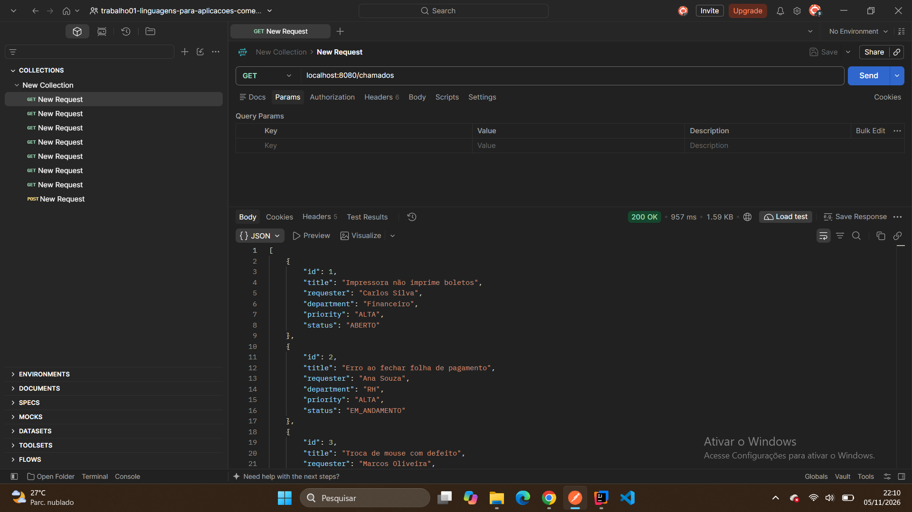

---

### Teste 2: Consultar chamado por ID existente (`GET /chamados/7`)

- **Requisição:**
  ```http
  GET http://localhost:8080/chamados/7
  ```
- **Resposta HTTP:** `200 OK`
- **Corpo da Resposta (JSON):**
  ```json
  {
    "id": 7,
    "title": "Criação de e-mail para novo colaborador",
    "requester": "Patrícia Gomes",
    "department": "RH",
    "priority": "BAIXA",
    "status": "ABERTO"
  }
  ```
- **Explicação do resultado:** O parâmetro de rota `{id}` (`7`) é capturado via `@PathVariable`, localizado na base em memória e retornado individualmente com status `200 OK`.

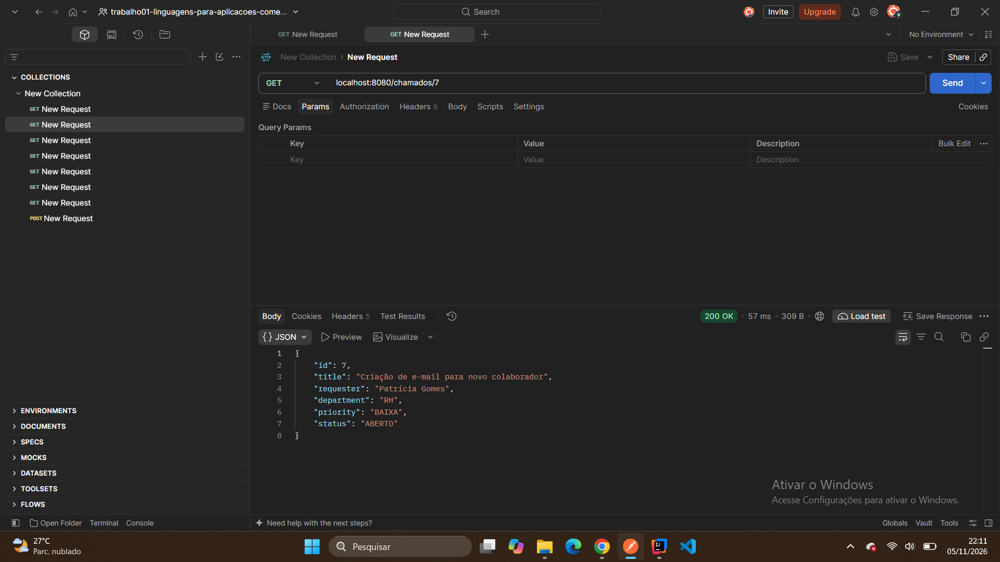

---

### Teste 3: Consultar chamado por ID inexistente (`GET /chamados/11`)

- **Requisição:**
  ```http
  GET http://localhost:8080/chamados/11
  ```
- **Resposta HTTP:** `404 Not Found`
- **Corpo da Resposta (JSON):**
  ```json
  {
    "timestamp": "2026-11-06T01:12:09Z",
    "status": 404,
    "error": "Recurso não encontrado",
    "message": "Id 11 não encontrado",
    "path": "/chamados/11"
  }
  ```
- **Explicação do resultado:** Quando o ID informado não existe, o `SupportTicketService` lança `ResourceNotFoundException`, que é interceptada pelo `ResourceExceptionHandler` (`@ControllerAdvice`), retornando um JSON padronizado com status `404 Not Found`.

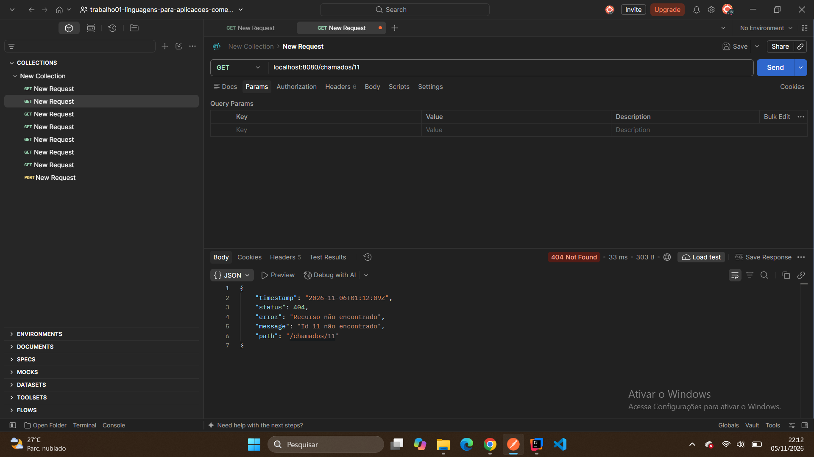

---

### Teste 4: Filtrar por setor em letras minúsculas (`GET /chamados/setor?nome=financeiro`)

- **Requisição:**
  ```http
  GET http://localhost:8080/chamados/setor?nome=financeiro
  ```
- **Resposta HTTP:** `200 OK`
- **Corpo da Resposta (JSON):**
  ```json
  [
    {
      "id": 1,
      "title": "Impressora não imprime boletos",
      "requester": "Carlos Silva",
      "department": "Financeiro",
      "priority": "ALTA",
      "status": "ABERTO"
    },
    {
      "id": 5,
      "title": "Instalação de pacote Office",
      "requester": "Fernanda Costa",
      "department": "Financeiro",
      "priority": "MEDIA",
      "status": "EM_ANDAMENTO"
    },
    {
      "id": 8,
      "title": "Sistema ERP travando na emissão de nota",
      "requester": "Lucas Martins",
      "department": "Financeiro",
      "priority": "ALTA",
      "status": "RESOLVIDO"
    }
  ]
  ```
- **Explicação do resultado:** Filtra os chamados pertencentes ao setor `"Financeiro"` mesmo tendo recebido o parâmetro `nome=financeiro` todo em minúsculas.

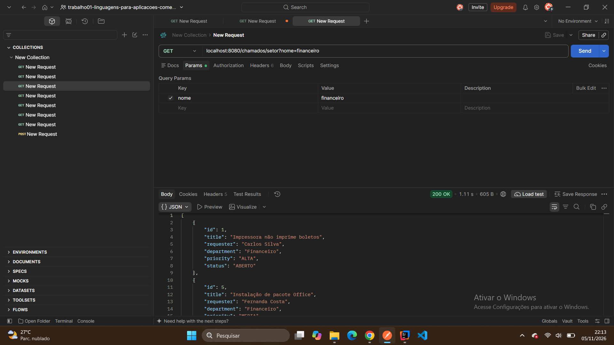

---

### Teste 5: Filtrar por setor em letras maiúsculas e mistas (`IgnoreCase`)

- **Requisições:**
  ```http
  GET http://localhost:8080/chamados/setor?nome=FINANCEIRO
  GET http://localhost:8080/chamados/setor?nome=fInAnCeIRo
  ```
- **Resposta HTTP:** `200 OK`
- **Explicação do resultado:** Comprova a regra de negócio de que as buscas textuais **não diferenciam maiúsculas de minúsculas** (`findByDepartmentIgnoreCase`), retornando exatamente os mesmos chamados do setor Financeiro independentemente da grafia.

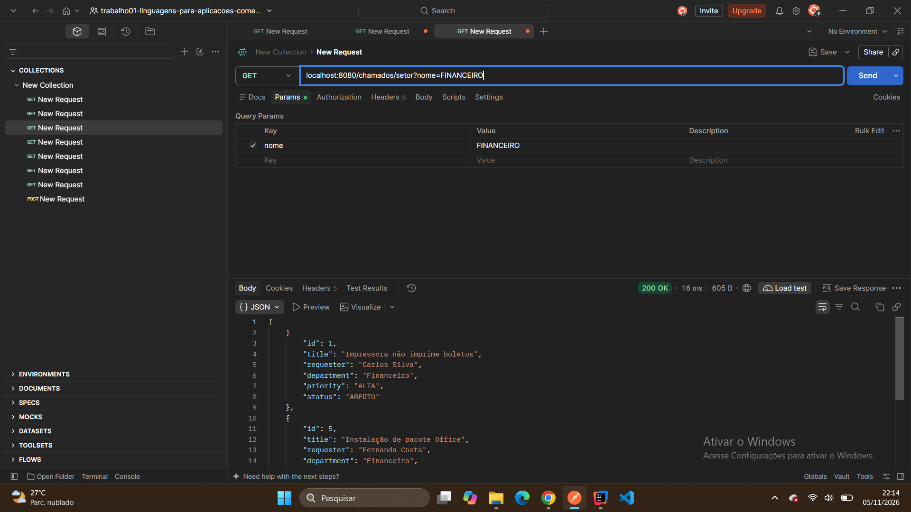


---

### Teste 6: Filtrar por prioridade (`ALTA`, `BAIXA` e `MEDIA`)

- **Requisições:**
  ```http
  GET http://localhost:8080/chamados/prioridade?nivel=alta
  GET http://localhost:8080/chamados/prioridade?nivel=baixa
  GET http://localhost:8080/chamados/prioridade?nivel=media
  ```
- **Resposta HTTP:** `200 OK`
- **Corpo da Resposta para `nivel=baixa` (JSON):**
  ```json
  [
    {
      "id": 3,
      "title": "Troca de mouse com defeito",
      "requester": "Marcos Oliveira",
      "department": "Comercial",
      "priority": "BAIXA",
      "status": "RESOLVIDO"
    },
    {
      "id": 7,
      "title": "Criação de e-mail para novo colaborador",
      "requester": "Patrícia Gomes",
      "department": "RH",
      "priority": "BAIXA",
      "status": "ABERTO"
    }
  ]
  ```
- **Explicação do resultado:** O parâmetro `nivel` recebido via `@RequestParam("nivel")` é convertido para maiúsculas (`level.toUpperCase()`) no Service e transformado no enum `Priority` correspondente, retornando apenas os chamados daquela prioridade.

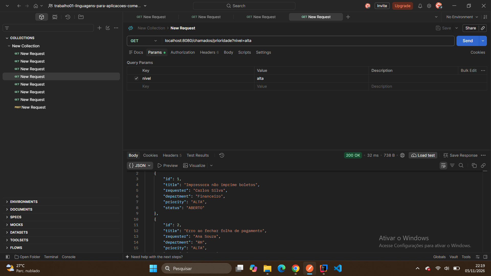


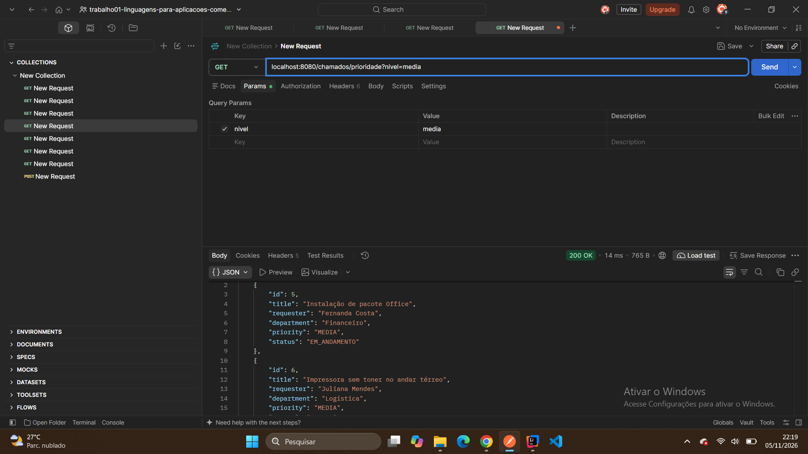

---

### Teste 7: Filtrar por prioridade inválida (`GET /chamados/prioridade?nivel=mediana`)

- **Requisição:**
  ```http
  GET http://localhost:8080/chamados/prioridade?nivel=mediana
  ```
- **Resposta HTTP:** `400 Bad Request`
- **Corpo da Resposta (JSON):**
  ```json
  {
    "timestamp": "2026-11-06T01:19:59Z",
    "status": 400,
    "error": "Argumento inválido",
    "message": "Prioridade inválida: mediana",
    "path": "/chamados/prioridade"
  }
  ```
- **Explicação do resultado:** Ao informar um nível de prioridade que não existe no enum `Priority` (`mediana`), o Service lança `IllegalArgumentException` e o `ResourceExceptionHandler` responde com status `400 Bad Request` detalhando o erro.

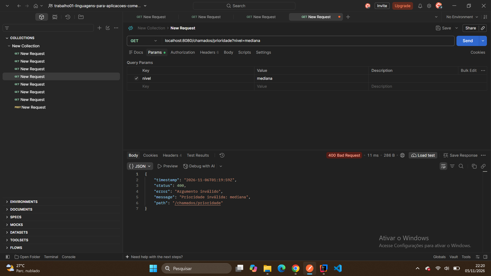

---

### Teste 8: Buscar pelo título (`GET /chamados/busca?texto=...`)

- **Requisições:**
  ```http
  GET http://localhost:8080/chamados/busca?texto=sistema
  GET http://localhost:8080/chamados/busca?texto=com
  ```
- **Resposta HTTP:** `200 OK`
- **Corpo da Resposta para `texto=sistema` (JSON):**
  ```json
  [
    {
      "id": 8,
      "title": "Sistema ERP travando na emissão de nota",
      "requester": "Lucas Martins",
      "department": "Financeiro",
      "priority": "ALTA",
      "status": "RESOLVIDO"
    }
  ]
  ```
- **Explicação do resultado:** Utiliza `findByTitleContainingIgnoreCase` para realizar busca parcial (substring) no título sem diferenciar maiúsculas de minúsculas. Na busca por `sistema`, encontra `"Sistema ERP..."`; na busca por `com`, retorna todos os chamados cujo título contém a sequência `"com"`.

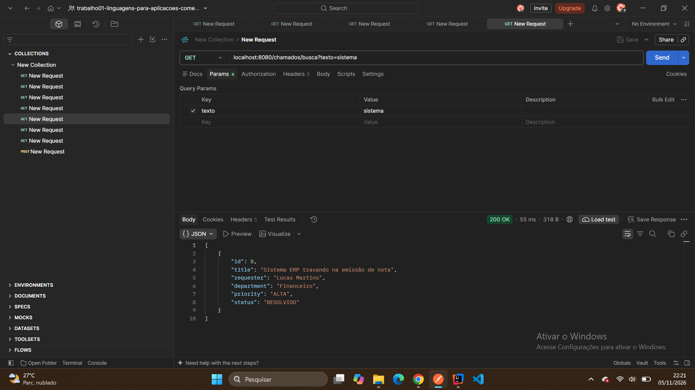

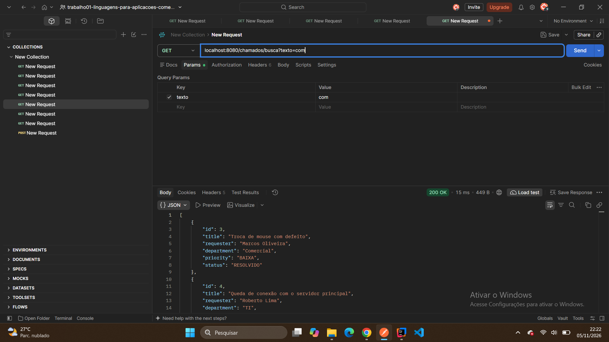

---

### Teste 9: Listar chamados críticos (`GET /chamados/criticos`)

- **Requisição:**
  ```http
  GET http://localhost:8080/chamados/criticos
  ```
- **Resposta HTTP:** `200 OK`
- **Corpo da Resposta (JSON):**
  ```json
  [
    {
      "id": 1,
      "title": "Impressora não imprime boletos",
      "requester": "Carlos Silva",
      "department": "Financeiro",
      "priority": "ALTA",
      "status": "ABERTO"
    },
    {
      "id": 2,
      "title": "Erro ao fechar folha de pagamento",
      "requester": "Ana Souza",
      "department": "RH",
      "priority": "ALTA",
      "status": "EM_ANDAMENTO"
    },
    {
      "id": 4,
      "title": "Queda de conexão com o servidor principal",
      "requester": "Roberto Lima",
      "department": "TI",
      "priority": "ALTA",
      "status": "ABERTO"
    }
  ]
  ```
- **Explicação do resultado:** Combina **prioridade** e **status** através do método `findByPriorityAndStatusNot(Priority.ALTA, Status.RESOLVIDO)`. Note que o chamado de ID `8` (que também tem prioridade `ALTA`, mas já está `RESOLVIDO`) foi corretamente excluído do resultado.

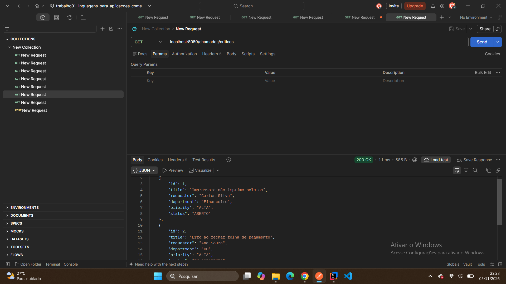

---

### Teste 10: Retornar a quantidade de chamados por status (`GET /chamados/resumo`)

- **Requisição:**
  ```http
  GET http://localhost:8080/chamados/resumo
  ```
- **Resposta HTTP:** `200 OK`
- **Corpo da Resposta (JSON):**
  ```json
  {
    "abertos": 4,
    "emAndamento": 3,
    "resolvidos": 3,
    "total": 10
  }
  ```
- **Explicação do resultado:** Contabiliza os chamados por cada estado (`Status.ABERTO`, `Status.EM_ANDAMENTO`, `Status.RESOLVIDO`) e o total geral (`repository.count()`), retornando um objeto JSON estruturado na ordem definida pelo `LinkedHashMap`.

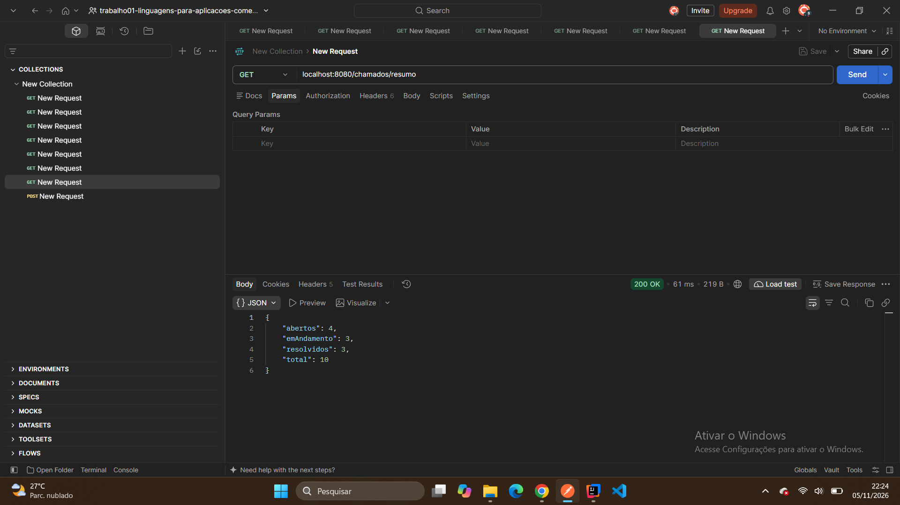

---

### Teste 11: Cadastrar um novo chamado via `POST /chamados` (JSON em Inglês e Português)

#### 11.1. Cadastro enviando chaves em inglês
- **Requisição:**
  ```http
  POST http://localhost:8080/chamados
  Content-Type: application/json
  ```
  ```json
  {
    "title": "Roteador com mau funcionamento",
    "requester": "Samuel de Almeida",
    "department": "financeiro",
    "priority": "MEDIA",
    "status": "EM_ANDAMENTO"
  }
  ```
- **Resposta HTTP:** `201 Created`
- **Corpo da Resposta (JSON):**
  ```json
  {
    "id": 12,
    "title": "Roteador com mau funcionamento",
    "requester": "Samuel de Almeida",
    "department": "financeiro",
    "priority": "MEDIA",
    "status": "EM_ANDAMENTO"
  }
  ```

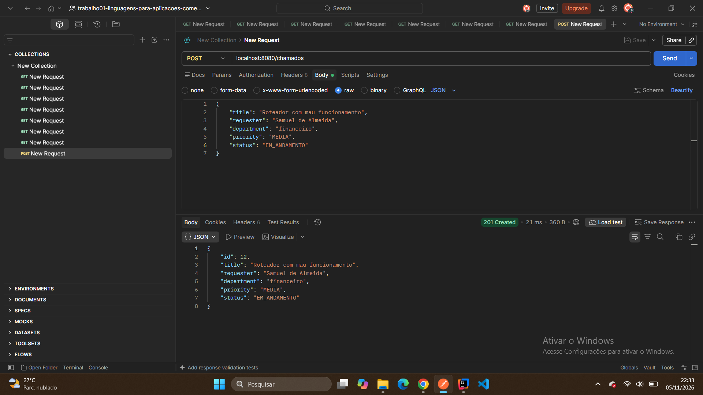

#### 11.2. Cadastro enviando chaves em português (via `@JsonAlias`)
- **Requisição:**
  ```http
  POST http://localhost:8080/chamados
  Content-Type: application/json
  ```
  ```json
  {
    "título": "Computador com malware",
    "solicitante": "Maria Brown",
    "setor": "RH",
    "prioridade": "ALTA",
    "estado": "RESOLVIDO"
  }
  ```
- **Resposta HTTP:** `201 Created`
- **Corpo da Resposta (JSON):**
  ```json
  {
    "id": 15,
    "title": "Computador com malware",
    "requester": "Maria Brown",
    "department": "RH",
    "priority": "ALTA",
    "status": "RESOLVIDO"
  }
  ```
- **Explicação do resultado:** Em ambos os testes, o endpoint `POST /chamados` recebe o corpo JSON, gera automaticamente um identificador único (`id`), persiste o chamado em memória e retorna o código HTTP **`201 Created`** juntamente com o cabeçalho `Location` e o objeto criado.

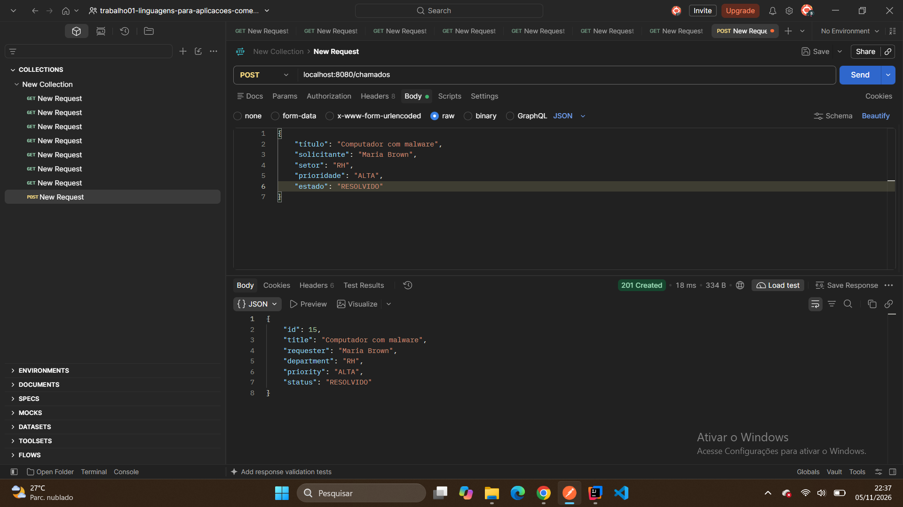

---

## 4. Como Executar o Projeto

### Pré-requisitos
- **Java 17+** (ou Java 21)
- **Maven** (ou utilizar o wrapper `./mvnw` incluso no projeto)

### Passos
1. Clone o repositório e acesse a pasta do projeto:
   ```bash
   git clone <url-do-repositorio>
   cd trabalho01
   ```
2. Execute a aplicação via Maven Wrapper:
   ```bash
   ./mvnw spring-boot:run
   ```
3. A API estará disponível em:
   ```text
   http://localhost:8080/chamados
   ```
